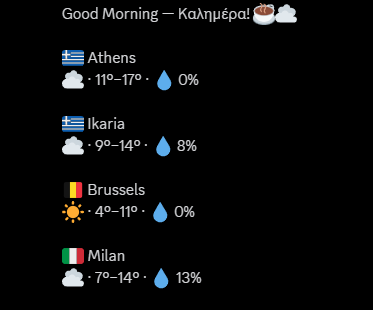
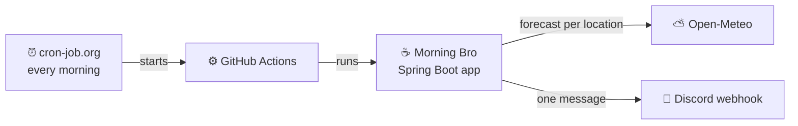

# Morning Bro ☕⛅

[](https://github.com/lefpap/morning-bro/actions/workflows/ci.yml)


[](LICENSE)

A good-morning bot for a group of friends who live in different places. Every morning it posts one message to a Discord channel: a greeting, plus a quick look at the weather wherever each of you is. You pick the places, the greeting and the time zone.



<sub>An example message with four locations.</sub>

## What it does

- **One friendly message a day**: a greeting, then each of your locations with its flag, a weather emoji, the day's low and high, and the chance of rain.
- **Friday gets a bonus line**: *Take it easy Friday! 😎*
- **The greeting always goes out.** If the weather service fails for one place, that line says *(weather is taking the day off)* and the rest still posts.
- **Dry-run mode** logs the message instead of posting it, so you can preview changes safely.
- **Costs nothing to run**: [Open-Meteo](https://open-meteo.com) needs no API key, and GitHub Actions and cron-job.org are free.

## Quick start

You need JDK 27. Maven isn't needed; the wrapper is included.

```bash
git clone https://github.com/lefpap/morning-bro.git && cd morning-bro
MORNING_BRO_DRY_RUN=true ./mvnw spring-boot:run
```

```powershell
$env:MORNING_BRO_DRY_RUN='true'; .\mvnw spring-boot:run; Remove-Item Env:MORNING_BRO_DRY_RUN
```

The message appears in your log. No Discord webhook needed.

## How it works



It's a run-once app: it starts, fetches each location's forecast, builds the message, posts it and exits. More in [docs/architecture.md](docs/architecture.md).

## Make it yours

The places, the greeting, the Friday line and the time zone are all in `src/main/resources/application.yaml`. To add a location:

```yaml
morning-bro:
  locations:
    # …existing locations
    - name: Berlin
      country-code: DE
      latitude: 52.52
      longitude: 13.41
```


### Configuration

<details>
<summary>All configuration keys</summary>

Everything except run-on-startup lives in `src/main/resources/application.yaml`.

| Key | What it does | Default | Env var |
|---|---|---|---|
| `morning-bro.time-zone` | Decides what "today" and "Friday" mean | `Europe/Athens` | – |
| `morning-bro.home` | Name of the location whose weather emoji goes in the header | `Athens` | – |
| `morning-bro.message.morning` | The greeting | `Good Morning — Καλημέρα! ☕` | – |
| `morning-bro.message.friday` | Added to the header on Fridays | `Take it easy Friday! 😎` | – |
| `morning-bro.locations[]` | Locations to report on, in order: `name`, `country-code`, `latitude`, `longitude` | Athens, Ikaria, Brussels, Milan | – |
| `morning-bro.dry-run` | Log the message instead of posting it | `false` | `MORNING_BRO_DRY_RUN` |
| `morning-bro.run-on-startup` | Run the job as soon as the app starts (tests set it to `false`) | `true` (not in the yaml) | – |
| `spring.http.serviceclient.discord.base-url` | The Discord webhook URL (a secret) | empty | `MORNING_BRO_DISCORD_WEBHOOK_URL` |
| `spring.http.clients.connect-timeout` / `read-timeout` | HTTP timeouts for both clients | `5s` / `10s` | – |

Validation rules: see [docs/architecture.md](docs/architecture.md#configuration-and-secrets).

</details>

## Post to your Discord

To run your own copy every day, fork the repo first, so the workflow and its secret live in your fork.

1. Create a webhook: Discord channel, *Edit Channel*, *Integrations*, *Webhooks*, *New Webhook*, *Copy Webhook URL*. It looks like `https://discord.com/api/webhooks/<id>/<token>`. Treat the URL as a password.
2. Locally: `cp .env.example .env`, fill in `MORNING_BRO_DISCORD_WEBHOOK_URL`, then `./mvnw spring-boot:run`. `.env` is gitignored, and real environment variables override it.
3. On GitHub (in your fork): `gh secret set MORNING_BRO_DISCORD_WEBHOOK_URL` (it prompts for the value, so the URL never lands in your shell history).
4. Run it every morning: set up the daily trigger described in [docs/operations.md](docs/operations.md).

## Development

```bash
./mvnw test
```

Tests never touch the network and never start the job on application startup. CI runs `./mvnw verify` on every push and PR to `master`.

To run it as a jar, like the daily workflow does:

```bash
./mvnw -DskipTests package
java -jar target/morning-bro-0.0.1-SNAPSHOT.jar
```

```
src/main/java/io/github/lefpap/morningbro/
  weather/         Open-Meteo client and forecast mapping
  message/         builds the Discord message text
  notification/    Discord webhook client and publisher
src/main/resources/application.yaml   all configuration
.github/workflows/                    morning-bro.yml (daily run), ci.yml
docs/                                 product, architecture and operations docs
```

## Docs

- [docs/product.md](docs/product.md): what it does, the message rules and known limits.
- [docs/architecture.md](docs/architecture.md): packages, failure handling, scheduling and design decisions.
- [docs/operations.md](docs/operations.md): the daily trigger, its token, and day-to-day commands.

## Credits

Weather data by [Open-Meteo.com](https://open-meteo.com/), licensed under [CC BY 4.0](https://creativecommons.org/licenses/by/4.0/).

## License

[MIT](LICENSE)
