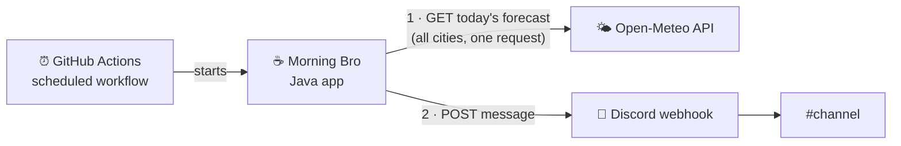

# Architecture

How Morning Bro is built. For what it does and why, see [PRODUCT.md](PRODUCT.md).

## Overview

Morning Bro is a **short-lived batch job**, not a service. A scheduler starts it, it decides whether it's time to post, fetches today's forecast for all cities, composes one message, posts it to Discord, and exits. There is no server, database, or persisted state.



## Technology stack

| Concern | Choice |
|---|---|
| Language | Java 27, without preview features |
| Build | Maven, Shade plugin for a single runnable jar |
| JSON | Jackson (`jackson-databind`), mapping to records |
| Config file | YAML via Jackson (`jackson-dataformat-yaml`), mapped to the same settings records |
| HTTP | `java.net.http.HttpClient` (JDK) |
| Tests | JUnit 5 |
| Scheduling, secrets | GitHub Actions |
| Weather data | Open-Meteo (free, no API key, one request for all cities) |
| Delivery | Discord channel webhook (send-only) |

No framework, and no Discord bot account. The job runs for seconds a day and only sends, so wiring is done by hand in the entry point.

## Code organization

Code is organized **by feature**. Each package owns one capability and exposes a small public API; everything else is package-private.

```
io/github/lefpap/morningbro/
├── MorningBro.java            entry point: wiring + daily flow
├── config/
│   ├── AppConfig.java         loads morning-bro.yml + env vars, validates, hands each feature its own part
│   └── City.java              name, flag, latitude, longitude
├── schedule/
│   ├── ScheduleSettings.java  send hour + timezone
│   └── SendWindow.java        is it time to post?
├── weather/
│   ├── WeatherSettings.java   rain thresholds, emoji per condition
│   ├── Condition.java         enum: CLEAR, RAIN, SNOW, …, UNLIKELY_RAIN, UNKNOWN
│   ├── TemperatureAlert.java  enum: HOT, FREEZING
│   ├── Forecast.java          today's weather code, min/max temp, rain chance
│   ├── WeatherService.java    forecasts for a list of cities
│   ├── WeatherEmoji.java      forecast → Condition + TemperatureAlert (rules) → emoji (from settings)
│   └── OpenMeteoClient.java   (package-private) HTTP + response records
├── greeting/
│   ├── GreetingSettings.java  greeting, Friday line, fallback note, home city
│   ├── MorningMessage.java    platform-neutral message: greeting lines + city lines
│   └── MessageComposer.java   builds the MorningMessage for a given day
└── discord/
    ├── DiscordSettings.java   webhook URL, bot name, avatar, accent color, footer
    ├── DiscordPublisher.java  sends a MorningMessage to the channel
    ├── DiscordMapper.java     (package-private) MorningMessage → payload + embed
    └── WebhookClient.java     (package-private) payload records + POST
```

### Rules
- **Dependencies point one way:** `greeting → weather`, `discord → greeting`. `weather` and `discord` never know about each other, and nothing depends on `MorningBro`.
- **The message is platform-neutral.** `greeting` produces a `MorningMessage`; only `discord` knows about embeds, colors, usernames and webhooks. Another platform means a new package next to `discord`.
- **No global config.** Each feature has a settings record. `AppConfig` builds them, and `MorningBro` passes each feature only its own. Features never read the config file or environment variables directly.
- **Rules in code, presentation in config.** Which weather codes count as rain, when rain becomes unlikely, and when a temperature alert applies are product rules in `WeatherEmoji`. Which emoji represents each `Condition` and `TemperatureAlert` comes from the config file.
- **One level deep.** No sub-packages until a feature outgrows a handful of classes.
- **Product rules live in pure classes** (`SendWindow`, `WeatherEmoji`, `MessageComposer`, `DiscordMapper`), so they're testable without network access.

## Application flow

1. **Trigger.** GitHub Actions runs the job hourly at minute :07, or manually (which sets `FORCE=true`).
2. **Load config.** `AppConfig` reads `morning-bro.yml` and the env vars, and validates them. A missing file, unknown key, or invalid value fails the run.
3. **Time gate.** `SendWindow` checks whether it's the configured hour in the configured timezone. If not, and the run isn't forced, the app exits with success.
4. **Fetch.** `WeatherService` gets today's forecast for all cities in one request and maps it to `Forecast` records. Unexpected or partial data is an error.
5. **Compose.** `MessageComposer` builds the `MorningMessage`: greeting, Friday line on Fridays, and one line per city.
6. **Fallback.** If step 4 or 5 fails, `composeFallback` produces the greeting plus the fallback note, with no city lines.
7. **Publish.** `DiscordPublisher` maps the message to a webhook payload and POSTs it. With `DRY_RUN=true`, the payload is printed instead.
8. **Report.** A failed post or invalid config exits non-zero. The workflow run fails, and GitHub notifies the owner.

## Scheduling

GitHub Actions cron runs in UTC only. The workflow therefore runs **every hour**, and the app is the single authority on when to post. `SendWindow` matches the configured hour in the configured timezone, which keeps the post at the same local time across daylight-saving changes. Send time has one-hour granularity.

## Configuration

All non-secret settings live in **`morning-bro.yml`** at the repository root. Changing a text, emoji, city, or the send time is an edit and a commit, with no code change. The file is read at runtime, not bundled into the jar. `CONFIG_PATH` can point to a different file.

```yaml
schedule:
  hour: 8
  timezone: Europe/Athens

cities:
  - { name: Athens,   flag: "🇬🇷", lat: 37.98, lon: 23.73 }
  - { name: Brussels, flag: "🇧🇪", lat: 50.85, lon: 4.35 }
  - { name: Milan,    flag: "🇮🇹", lat: 45.46, lon: 9.19 }

greeting:
  text: "Good Morning — Καλημέρα! ☕"
  homeCity: Athens                      # its weather emoji is appended to the greeting
  friday: "Take it easy Friday! 😎"
  fallback: "(weather is taking the day off)"

weather:
  likelyRainPercent: 40                 # below this, rain/storm shows as unlikelyRain
  showRainPercent: 20                   # at or above this, "☔ NN%" is shown
  emoji:
    clear: "☀️"
    mostlyClear: "🌤️"
    partlyCloudy: "⛅"
    overcast: "☁️"
    fog: "🌫️"
    drizzle: "🌦️"
    rain: "🌧️"
    snow: "🌨️"
    thunderstorm: "⛈️"
    unknown: "🌡️"
    unlikelyRain: "🌦️"
  alertEmoji:                           # shown after the condition emoji, never instead of it
    hot: "🥵"                           # high ≥ 35°
    freezing: "🥶"                      # low ≤ 0°

discord:
  username: "Morning Bro"
  avatarUrl: null
  color: "#6F4E37"
  footer: "Forecast by Open-Meteo"
```

Validation (at startup, fails the run): every `Condition` and `TemperatureAlert` has an emoji, `homeCity` is one of `cities`, the hour is 0–23, the timezone is known, coordinates are in range, and there are no unknown keys.

Environment variables, for secrets and runtime flags only:

| Variable | Source | Default |
|---|---|---|
| `DISCORD_WEBHOOK_URL` | GitHub secret | required unless `DRY_RUN` |
| `CONFIG_PATH` | env var | `morning-bro.yml` |
| `FORCE` | set by the workflow on manual runs | `false` |
| `DRY_RUN` | env var | `false` |

Secrets never go in `morning-bro.yml`.

## Build and CI

- **`ci.yml`** runs on every push and PR: `mvn verify`, then a dry run of the built jar with the real `morning-bro.yml`, so a broken config fails CI before it reaches a morning run.
- **`morning.yml`** runs hourly and on demand: builds with `-DskipTests` and runs the jar. A broken test can't cancel a morning post; CI catches it at push time.
- Tests mirror the feature packages (`src/test/java/io/github/lefpap/morningbro/<feature>/`) and use a recorded Open-Meteo response; they make no network calls.

## Constraints

- GitHub cron is best-effort. Runs can start minutes late and are occasionally skipped.
- Scheduled workflows are paused in public repositories after 60 days without commits.
- Open-Meteo's free tier is non-commercial and requires attribution, shown in the message footer.
- Open-Meteo's daily weather code is the day's *worst* condition, which is why the emoji rules use rain probability to soften it.
