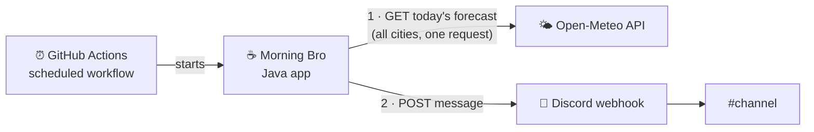

# Architecture

How Morning Bro is built. For what it does and why, see [PRODUCT.md](PRODUCT.md).

## Overview

Morning Bro is a **short-lived batch job**, not a service. A scheduler starts it, it decides whether it's time to post, fetches today's forecast for all cities, composes one message, posts it to Discord, and exits. There is no server, database, or persisted state.



## Technology stack

| Concern | Choice |
|---|---|
| Language | Java 27, without preview features |
| Build | Maven, Shade plugin for a single runnable jar |
| JSON | Jackson (`jackson-databind`), mapping to records |
| Config file | YAML via Jackson (`jackson-dataformat-yaml`), mapped to the same settings records |
| HTTP | `java.net.http.HttpClient` (JDK) |
| Tests | JUnit 5, AssertJ, Mockito (forecast source only) |
| Scheduling, secrets | GitHub Actions |
| Weather data | Open-Meteo (free, no API key, one request for all cities) |
| Delivery | Discord channel webhook (send-only) |

No framework, and no Discord bot account. The job runs for seconds a day and only sends, so wiring is done by hand in the entry point.

## Code organization

Code is organized **by feature**. Each package owns one capability and exposes a small public API; everything else is package-private.

```
io/github/lefpap/morningbro/
├── MorningBro.java            entry point: wiring + daily flow
├── settings/
│   └── Settings.java          loads application.yml + env vars, validates, hands each feature its own part
├── schedule/
│   ├── ScheduleSettings.java  send hour + timezone
│   └── SendWindow.java        is it time to post?
├── weather/
│   ├── City.java              name, flag, latitude, longitude
│   ├── WeatherSettings.java   rain thresholds, emoji per condition, the Attribution
│   ├── Condition.java         enum: CLEAR, RAIN, SNOW, …, UNLIKELY_RAIN, UNKNOWN
│   ├── TemperatureAlert.java  enum: HOT, FREEZING
│   ├── Forecast.java          day, weather code, min/max temp, rain chance
│   ├── WeatherService.java    one Forecast per city for the Forecast Day; rejects partial or unexpected forecasts
│   ├── OpenMeteoClient.java   the only class that knows Open-Meteo: HTTP + response records
│   ├── WeatherException.java  the forecast couldn't be fetched, or came back partial or unexpected
│   └── WeatherEmoji.java      forecast → Condition + TemperatureAlert (rules) → emoji (from settings)
├── messaging/
│   ├── GreetingSettings.java  greeting, Friday line, fallback note, home city
│   ├── MorningMessage.java    sealed, platform-neutral data: WithWeather (Greeting, Home City emoji, Friday Line,
│   │                          Weather Report, Attribution) or Fallback (Greeting, Friday Line, Fallback Note); nothing formatted
│   ├── CityForecast.java      one city's entry in the Weather Report: city, emoji, rounded low/high, Rain Chance to show
│   ├── MorningMessageFactory.java  the product rules: forecasts → MorningMessage, or the Fallback Message
│   │                          when there's no forecast for the Home City (an empty map means the weather is unavailable)
│   ├── MessagePublisher.java  interface: delivers a MorningMessage on one platform
│   ├── console/
│   │   ├── ConsoleMessageComposer.java   MorningMessage → plain text, the Attribution as the last line
│   │   └── ConsoleMessagePublisher.java  prints its composer's text to the run log
│   └── discord/
│       ├── DiscordSettings.java   webhook URL, bot name, avatar
│       ├── DiscordException.java  the post failed or Discord rejected it
│       ├── DiscordMessageComposer.java   MorningMessage → webhook payload, all plain text in Discord's markdown: greeting lines
│       │                          first (they show in notifications), one City Forecast per line, Attribution as subtext
│       ├── WebhookPayload.java    the payload record, as Discord's webhook API takes it
│       └── DiscordMessagePublisher.java  POSTs its composer's payload to the Channel; with DRY_RUN, prints it instead
```

### Rules
- **Dependencies point one way:** `messaging → weather`, and each platform sub-package → `messaging`. Platform sub-packages never know about each other, `weather` knows nothing about the message, and nothing depends on `MorningBro`.
- **The message is platform-neutral; publishers are not.** `MorningMessageFactory` applies the product rules once and produces a `MorningMessage` with nothing formatted. Each platform has a sub-package of `messaging` (`console`, `discord`) with a composer that structures and formats the message for that platform, and a `MessagePublisher` that delivers what its composer makes. The publisher is given its composer; `MorningBro` wires the two together. Another platform means another sub-package next to them.
- **No global settings object.** Each feature has a settings record. `Settings` builds them, and `MorningBro` passes each feature only its own. Features never read the Settings File or environment variables directly.
- **Rules in code, presentation in config.** Which weather codes count as rain, when rain becomes unlikely, and when a temperature alert applies are product rules in `WeatherEmoji`. Which emoji represents each `Condition` and `TemperatureAlert` comes from the config file.
- **The entry point picks the forecast source.** `MorningBro` wires `new WeatherService(new OpenMeteoClient())`; everything else uses `WeatherService` and never names the source.
- **A weather failure is not a failed run.** `WeatherService` throws `WeatherException`; `MorningBro` logs it for the Owner and carries on with no forecasts, so the Fallback Message goes out. Nothing else catches it.
- **One level deep, except platforms.** No sub-packages until a feature outgrows a handful of classes. The one exception is `messaging`, which keeps each platform in its own sub-package.
- **Product rules live in pure classes** (`SendWindow`, `WeatherEmoji`, `MorningMessageFactory`, the composers), so they're testable without network access.

## Application flow

1. **Trigger.** GitHub Actions runs the job hourly at minute :07, or manually (which sets `FORCE=true`).
2. **Load settings.** `Settings` reads `application.yml` and the env vars, and validates them. A missing file, unknown key, or invalid value fails the run.
3. **Time gate.** `SendWindow` checks whether it's the configured hour in the configured timezone. If not, and the run isn't forced, the app exits with success.
4. **Fetch.** `WeatherService` gets the Forecast Day for all cities in one request through `OpenMeteoClient`, which maps the response to `Forecast` records. `WeatherService` checks there is one per city, each for the Forecast Day. Unexpected or partial data is a `WeatherException`: `MorningBro` logs why the weather is unavailable and carries on with no forecasts (an empty map).
5. **Build the message.** `MorningMessageFactory` builds the `MorningMessage`: the greeting with the Home City's emoji, the Friday Line on Fridays, and one City Forecast per city. With no forecast for the Home City, which includes no forecasts at all, it builds the Fallback Message instead: the greeting text, the Friday Line on Fridays, and the Fallback Note, with no Weather Report. It never builds a partly filled Weather Report.
6. **Show it in the run log.** `ConsoleMessagePublisher` prints the message as plain text, so the Owner can check it.
7. **Publish.** `DiscordMessagePublisher` turns the message into a webhook payload and POSTs it. With `DRY_RUN=true`, the payload is printed instead. A failed or rejected post is a `DiscordException`, and `MorningBro` exits non-zero.
8. **Report.** A failed post or invalid config exits non-zero. The workflow run fails, and GitHub notifies the owner. An unavailable weather does not: the Fallback Message still goes out.

## Scheduling

GitHub Actions cron runs in UTC only. The workflow therefore runs **every hour**, and the app is the single authority on when to post. `SendWindow` matches the configured hour in the configured timezone, which keeps the post at the same local time across daylight-saving changes. Send time has one-hour granularity.

## Configuration

All non-secret settings live in **`src/main/resources/application.yml`**. Changing a text, emoji, city, or the send time is an edit and a commit, with no code change. The file is bundled into the jar, and the morning workflow builds the jar on every run, so a committed change applies from the next run. `SETTINGS_PATH` can point to a file on disk instead. Tests build their test cases from `src/test/resources/application-test.yml`.

```yaml
schedule:
  hour: 8
  timezone: Europe/Athens

cities:
  - { name: Athens,   flag: "🇬🇷", lat: 37.98, lon: 23.73 }
  - { name: Brussels, flag: "🇧🇪", lat: 50.85, lon: 4.35 }
  - { name: Milan,    flag: "🇮🇹", lat: 45.46, lon: 9.19 }

greeting:
  text: "Good Morning — Καλημέρα! ☕"
  home-city: Athens                     # its weather emoji is appended to the greeting
  friday: "Take it easy Friday! 😎"
  fallback: "(weather is taking the day off)"

weather:
  likely-rain-percent: 40               # below this, rain/storm shows as unlikely-rain
  show-rain-percent: 20                 # at or above this, "☔ NN%" is shown
  emoji:
    clear: "☀️"
    mostly-clear: "🌤️"
    partly-cloudy: "⛅"
    overcast: "☁️"
    fog: "🌫️"
    drizzle: "🌦️"
    rain: "🌧️"
    snow: "🌨️"
    thunderstorm: "⛈️"
    unknown: "🌡️"
    unlikely-rain: "🌦️"
  alert-emoji:                          # shown after the condition emoji, never instead of it
    hot: "🥵"                           # high ≥ 35°
    freezing: "🥶"                      # low ≤ 0°
  attribution: "Forecast by Open-Meteo"   # the forecast source's credit, which its terms require

discord:
  username: "Morning Bro"
  avatar-url: null
```

Validation (at startup, fails the run): every `Condition` and `TemperatureAlert` has an emoji, `home-city` is one of `cities`, the hour is 0–23, the timezone is known, coordinates are in range, and there are no unknown keys.

Environment variables, for secrets and runtime flags only:

| Variable | Source | Default |
|---|---|---|
| `DISCORD_WEBHOOK_URL` | GitHub secret | required unless `DRY_RUN` |
| `SETTINGS_PATH` | env var | the bundled `application.yml` |
| `FORCE` | set by the workflow on manual runs | `false` |
| `DRY_RUN` | env var | `false` |

Secrets never go in `application.yml`.

## Build and CI

- **`ci.yml`** runs on every push and PR: `mvn verify`, then a dry run of the built jar with the real `application.yml`, so a broken config fails CI before it reaches a morning run.
- **`morning.yml`** runs hourly and on demand: builds with `-DskipTests` and runs the jar. A broken test can't cancel a morning post; CI catches it at push time.
- Tests mirror the feature packages (`src/test/java/io/github/lefpap/morningbro/<feature>/`) and make no network calls.
  - `OpenMeteoClientTest` runs the real client against a local `HttpServer` that serves responses recorded from Open-Meteo, in `src/test/resources/open-meteo/`. Each file in `broken/` is `athens.json` with one value changed.
  - `WeatherServiceTest` mocks `OpenMeteoClient` with Mockito. Mockito is loaded as a `-javaagent` through surefire's `argLine`, so running tests from an IDE may need that agent added to the run configuration.
  - `DiscordMessagePublisherTest` runs the real publisher against a local `HttpServer` standing in for the webhook.
  - `MorningMessageFactoryTest` builds `Forecast`s by hand, and each composer's test builds `MorningMessage`s by hand, so neither needs a mock.
  - `MorningBro` and `ConsoleMessagePublisher` have no unit tests: one only wires features together, the other only prints `ConsoleMessageComposer`'s text. CI's dry run of the built jar covers them.

## Constraints

- GitHub cron is best-effort. Runs can start minutes late and are occasionally skipped.
- Scheduled workflows are paused in public repositories after 60 days without commits.
- Open-Meteo's free tier is non-commercial and requires attribution, shown as small text below the Weather Report.
- Open-Meteo's daily weather code is the day's *worst* condition, which is why the emoji rules use the Rain Chance to soften it.
