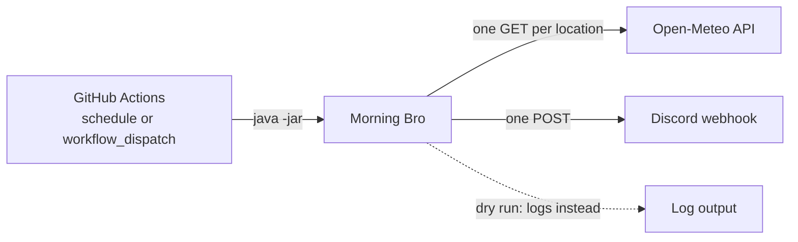
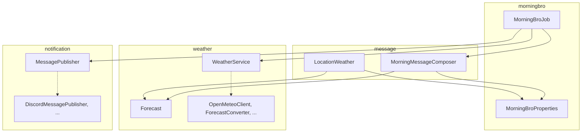
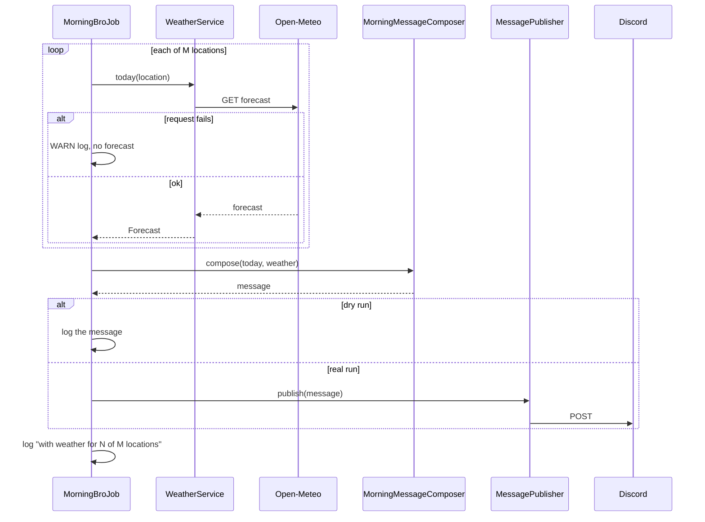

# Architecture

## Overview

Morning Bro is a run-once Spring Boot 4.1 app on Java 27. It has no web server (`web-application-type: none`). It starts, fetches weather, builds one message, posts it, and exits. Exit code 0 means the message was posted (or logged, on a dry run); non-zero means it was not posted.

Nothing in the code depends on GitHub Actions: configuration comes from `application.yaml` and environment variables only, so the same jar runs from a laptop or any scheduler.

## Packages

The base package is `io.github.lefpap.morningbro`, organised by feature in a modulith style: each feature exposes a small public API and keeps its adapter code package-private.

| Package | Public API | Internal |
|---|---|---|
| root | `MorningBroApplication`, `MorningBroJob`, `MorningBroProperties` | – |
| `weather` | `WeatherService`, `Forecast`, `OpenMeteoException` | `OpenMeteoClient`, `OpenMeteoClientConfig`, `OpenMeteoForecast`, `ForecastConverter`, `WeatherEmoji` |
| `message` | `MorningMessageComposer`, `LocationWeather` | `CountryFlag` |
| `notification` | `MessagePublisher` | `DiscordMessagePublisher`, `DiscordClientConfig`, `DiscordWebhookClient`, `DiscordMessage`, `DiscordWebhookException` |

Dependencies point from the job to each feature's public API, and from `message` to `weather.Forecast` and the root `MorningBroProperties`. Nothing outside a package reaches its internal types.

Dotted arrows stay inside their package: the public type is the only way in.

## A run step by step

- "Today" is `LocalDate.ofInstant(clock.instant(), timeZone)`. The injected `Clock` is UTC; the configured zone is applied by the job, never by the JVM default.
- `MorningMessageComposer` is pure: it never reads the clock, so the same inputs always give the same message.
- The `MessagePublisher` is looked up through an `ObjectProvider` only when posting, because a dry run has no publisher bean.
- A location whose weather throws becomes `LocationWeather` with no forecast and shows the "day off" line.

## Configuration and secrets

`MorningBroProperties` (`morning-bro.*`) is validated at startup: the time zone is set, there is at least one location, location names are unique, `home` matches a location name exactly, country codes match `[A-Z]{2}`, and coordinates are in range. Invalid config exits non-zero before any call is made.

The HTTP clients are Spring HTTP interfaces in the service groups `discord` and `openmeteo` (`spring.http.serviceclient.*`). They share 5 s connect and 10 s read timeouts and the JDK HTTP client.

Precedence, highest first: environment variables, then `.env`, then `application.yaml`. See the README config table for the key list.

## Failure handling

| Failure | Result | Exit code |
|---|---|---|
| One location's weather fails (HTTP error, timeout, bad data) | That location shows the "day off" line; WARN log | 0 |
| All weather fails | Greeting only | 0 |
| Invalid config | Startup error | non-zero |
| Webhook URL missing on a real run | `Discord webhook URL is not set: …` at startup, before any weather call | non-zero |
| Discord non-2xx (including 3xx, since redirects aren't followed) or I/O error | `DiscordWebhookException` | non-zero |

**Keeping the webhook URL secret.** The URL is the credential, so it must never reach the logs. Redirects are not followed. I/O errors are replaced by a message that names only the exception class, with no URL and no cause. Status errors carry only the status and its text.

## Scheduling

Two workflows live in `.github/workflows/`.

- **Morning Bro** (`morning-bro.yml`): runs on cron `50 7 * * *` with `timezone: "Europe/Athens"`, so it follows daylight saving time. 07:50 avoids the busy start of the hour. It can also be started with `workflow_dispatch`, whose `dry_run` input defaults to `true`. It builds with `-DskipTests` (CI already tested the commit) and runs `java -jar target/morning-bro-*.jar`. Its concurrency group does not cancel, so overlapping runs queue.
- **CI** (`ci.yml`): runs `./mvnw verify` on pushes and PRs to `master`. It uses no secrets and cancels stale runs.

Both use `contents: read`, `persist-credentials: false`, a 10-minute timeout, and Temurin 27 with the Maven cache.

## Testing

`./mvnw test` never hits the network (`MockRestServiceServer`, with closed local ports as a backstop) and never runs the job (`morning-bro.run-on-startup=false`). Fixed UTC clocks prove the zone logic.

- `MorningBroPropertiesTest`: every validation rule.
- `OpenMeteoClientTest`, `DiscordWebhookClientTest`: request shape, error mapping, no URL leaks.
- `ForecastConverterTest`, `WeatherEmojiTest`, `WeatherServiceTest`: conversion, rounding, emoji, zone.
- `MorningMessageComposerTest`, `CountryFlagTest`: message layout and flags.
- `MorningBroJobTest`: failure isolation, dry run, final log line.
- `DiscordClientConfigTest`: the beans that exist on a real run versus a dry run, and the missing-URL failure.

## Design decisions

- **One Open-Meteo request per location.** A failure affects one location only, and batched responses change shape (a list instead of an object).
- **No retries.** Each external call is attempted once. This is a deliberate v1 simplification (the user's decision); failures are handled by the rules in Failure handling.
- **A dry run removes the Discord beans entirely**, so no webhook URL is needed. Rejected: a logging publisher (it isn't a publisher) and `Optional<MessagePublisher>` (an Optional parameter needing an unreachable guard).
- **Half-up rounding to `int`.** Ties round away from zero, and an `int` result can't be negative zero.
- **`Locale.ROOT` formatting.** Digits and minus signs are the same whatever the host's default locale.
- **Layout in code, not templates.** The message is a few lines; a template engine would be more machinery than the format.
- **No client-side 2000-character check.** Discord's rejection is already a clear failure.

## Possible next steps

Not built; ideas only.

- A keep-alive workflow, since GitHub disables scheduled workflows after 60 days without repository activity.
- A move to Cloud Scheduler plus a Cloud Run Job, if GitHub's schedule proves unreliable.
- A softer emoji when the rain chance is low.
