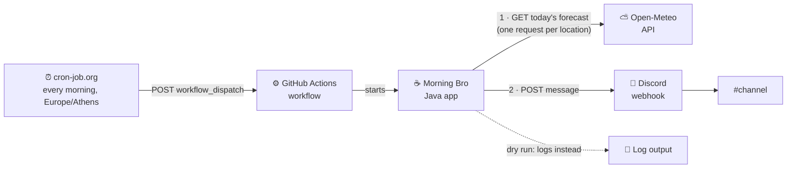

# Architecture

## Overview

Morning Bro is a run-once Spring Boot 4.1 app on Java 27. It has no web server (`web-application-type: none`). It starts, fetches weather, builds one message, posts it, and exits. Exit code 0 means the message was posted (or logged, on a dry run); non-zero means it was not posted.

Nothing in the code depends on GitHub Actions: configuration comes from `application.yaml` and environment variables only, so the same jar runs from a laptop or any scheduler.

## Packages

The base package is `io.github.lefpap.morningbro`, organised by feature in a modulith style: each feature exposes a small public API and keeps its adapter code package-private.

| Package | Public API | Internal |
|---|---|---|
| root | `MorningBroApplication`, `MorningBroJob`, `MorningBroProperties` | – |
| `weather` | `WeatherService`, `Forecast` | `OpenMeteoClient`, `OpenMeteoClientConfig`, `OpenMeteoException`, `OpenMeteoForecast`, `ForecastConverter`, `WeatherEmoji` |
| `message` | `MorningMessageComposer`, `LocationWeather` | `CountryFlag` |
| `notification` | `MessagePublisher` | `DiscordMessagePublisher`, `DiscordClientConfig`, `DiscordWebhookClient`, `DiscordMessage`, `DiscordWebhookException` |

Dependencies point from the job to each feature's public API, and from `weather` and `message` (and the job itself) to the root `MorningBroProperties`; `message` also uses `weather.Forecast`. Nothing outside a package reaches its internal types.

## A run step by step

1. The job works out today's date in the configured time zone.
2. For each location, in order, it asks `WeatherService` for today's forecast. A failed request logs a WARN and leaves that location without a forecast.
3. `MorningMessageComposer` builds the message from the date and the forecasts.
4. On a dry run the job logs the message; otherwise it hands it to `MessagePublisher`, which POSTs it to the Discord webhook.
5. The job logs `with weather for N of M locations` and exits.

- "Today" is `LocalDate.ofInstant(clock.instant(), timeZone)`. The injected `Clock` is UTC; the configured zone is applied by the job, never by the JVM default.
- `MorningMessageComposer` is pure: it never reads the clock, so the same inputs always give the same message.
- The `MessagePublisher` is looked up through an `ObjectProvider` only when posting, because a dry run has no publisher bean.
- A location whose weather throws becomes `LocationWeather` with no forecast and shows the "day off" line.

## Configuration and secrets

`MorningBroProperties` (`morning-bro.*`) is validated at startup: the time zone is set, there is at least one location, location names are unique, `home` matches a location name exactly, country codes match `[A-Z]{2}`, and coordinates are in range. Invalid config exits non-zero before any call is made.

The HTTP clients are Spring HTTP interfaces in the service groups `discord` and `openmeteo` (`spring.http.serviceclient.*`). They share 5 s connect and 10 s read timeouts and the JDK HTTP client.

Precedence, highest first: environment variables, then `.env`, then `application.yaml`. See the [README config table](../README.md#configuration) for the key list.

## Failure handling

| Failure | Result | Exit code |
|---|---|---|
| One location's weather fails (HTTP error, timeout, undecodable response) | That location shows the "day off" line; WARN log | 0 |
| One location's response has missing values | Same "day off" line; logged at INFO as `Forecast for X: N/A`, no WARN | 0 |
| All weather fails | Header without the weather emoji; every location shows the `(weather is taking the day off)` line | 0 |
| Invalid config | Startup error | non-zero |
| Webhook URL missing on a real run | `Discord webhook URL is not set: …` at startup, before any weather call | non-zero |
| Discord non-2xx (including 3xx, since redirects aren't followed) or I/O error | `DiscordWebhookException` | non-zero |

**Keeping the webhook URL secret.** The URL is the credential, so it must never reach the logs. Redirects are not followed. I/O errors are replaced by a message that names only the exception class, with no URL and no cause. Status errors carry only the status and its text.

## Scheduling

Two workflows live in `.github/workflows/`.

- **Morning Bro** (`morning-bro.yml`): runs only on `workflow_dispatch`, whose `dry_run` input defaults to `true`. An external [cron-job.org](https://cron-job.org) job calls the dispatch API every morning in `Europe/Athens` time (so it follows daylight saving time) with `dry_run=false`, authenticated by a fine-grained token limited to this repo with Actions: write. Setup and token rotation are in the [operations doc](operations.md#daily-trigger-cron-joborg). It builds with `-DskipTests` (CI already tested the commit) and runs `java -jar target/morning-bro-*.jar`. Its concurrency group does not cancel, so overlapping runs queue.
- **CI** (`ci.yml`): runs `./mvnw verify` on pushes and PRs to `master`. It uses no secrets and cancels stale runs.

**Why not GitHub's `schedule` event.** It was used first (`50 7 * * *`, `timezone: "Europe/Athens"`), but in its first week GitHub created the runs 7–8 hours late (13:02–13:52 UTC against 05:50 UTC). GitHub only says scheduled runs "can be delayed during periods of high loads" and may be dropped. Dispatched runs start within seconds. cron-job.org was chosen because it is free with no card, supports a per-job IANA time zone, and can send the POST with headers and a body. Its trade-offs: no documented punctuality guarantee or retries, and the token is stored by a third party. Runners-up were a Cloudflare Workers cron trigger (UTC only, needs code) and AWS EventBridge Scheduler (documented 60 s precision, but needs a Lambda and a paid-plan account). Moving the app off GitHub Actions wasn't worth a container image and a billing account.

Both use `contents: read`, `persist-credentials: false`, a 10-minute timeout, and Temurin 27 with the Maven cache.

## Testing

`./mvnw test` never hits the network (`MockRestServiceServer`, with closed local ports as a backstop) and never starts the job on application startup (`morning-bro.run-on-startup=false`). Fixed UTC clocks prove the zone logic.

- `MorningBroPropertiesTest`: the project's own config rules (home must name a location, location names are unique). The standard constraint annotations aren't re-tested.
- `OpenMeteoClientTest`, `DiscordWebhookClientTest`: request shape, error mapping, no URL leaks.
- `ForecastConverterTest`, `WeatherEmojiTest`, `WeatherServiceTest`: conversion, rounding, emoji, zone.
- `MorningMessageComposerTest`, `CountryFlagTest`: message layout and flags.
- `MorningBroJobTest`: failure isolation, dry run, final log line.
- `MorningBroApplicationTests`: the context loads with the real configuration.
- `DiscordClientConfigTest`: the beans that exist on a real run versus a dry run, and the missing-URL failure.

## Design decisions

- **One Open-Meteo request per location.** A failure affects one location only, and batched responses change shape (a list instead of an object).
- **No retries.** Each external call is attempted once. This is a deliberate v1 simplification (the owner's decision); failures are handled by the rules in Failure handling.
- **A dry run removes the Discord beans entirely**, so no webhook URL is needed. Rejected: a logging publisher (it isn't a publisher) and `Optional<MessagePublisher>` (an Optional parameter needing an unreachable guard).
- **Half-up rounding to `int`.** Ties round away from zero, and an `int` result can't be negative zero.
- **`Locale.ROOT` formatting.** Digits and minus signs are the same whatever the host's default locale.
- **Layout in code, not templates.** The message is a few lines; a template engine would be more machinery than the format.
- **No client-side 2000-character check.** Discord's rejection is already a clear failure.

## Possible next steps

Not built; ideas only.

- A Cloudflare Workers cron trigger instead of cron-job.org, if the token should live in an encrypted secret store or cron-job.org proves unreliable.
- A softer emoji when the rain chance is low.
